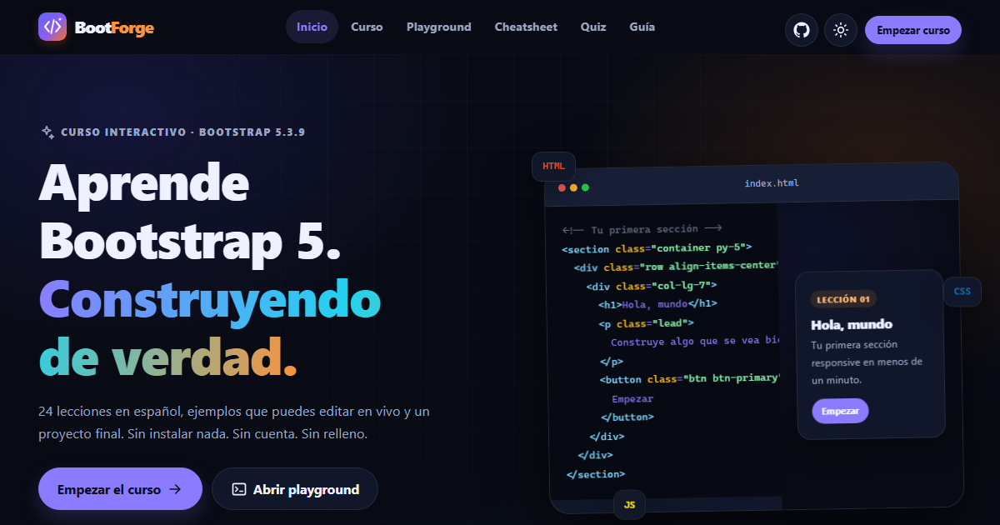

# BootForge

**Curso interactivo de Bootstrap 5 en español.** 24 lecciones, ejemplos editables en vivo, playground, cheatsheet, quiz final y una guía para publicar tu proyecto en GitHub Pages.

[](https://sebitas13.github.io/BootForge/)
[](https://github.com/Sebitas13/BootForge/releases)
[](https://github.com/Sebitas13/BootForge/actions/workflows/ci.yml)
[](https://github.com/Sebitas13/BootForge/actions/workflows/pages.yml)
[](LICENSE)
[](https://getbootstrap.com/docs/5.3/)



## Demo

**https://sebitas13.github.io/BootForge/**

No requiere registro, instalación ni backend. El progreso se guarda en `localStorage` y los ejemplos se ejecutan dentro de un iframe aislado.

---

## Qué incluye

| Área | Estado real |
|---|---|
| Curso | 9 módulos · 24 lecciones · 134 min estimados |
| Ejemplos | 38 bloques de código con copiar, probar y editar |
| Progreso | Persistente por lección, con reinicio y continuación |
| Búsqueda | Índice local de 24 lecciones, atajo `Ctrl/Cmd + K` |
| Playground | HTML + CSS + JS, 6 plantillas, consola y descarga standalone |
| Cheatsheet | 69 clases y patrones, búsqueda, filtros y copia |
| Quiz | 12 preguntas, explicaciones, revisión y mejor puntaje |
| Guía | Publicación paso a paso en GitHub Pages y checklist final |
| Accesibilidad | Skip link, un `h1` por página, landmarks, foco visible y contraste |
| Privacidad | Sin cookies, sin analytics, sin cuentas |

### Lo que **no** incluye

BootForge es un sitio estático. No hay login, base de datos, pagos ni un backend que ejecute el código del usuario. El playground corre en el navegador dentro de un iframe con `sandbox="allow-scripts allow-forms"` y sin `allow-same-origin`.

---

## Contenido del curso

1. **Primeros pasos** — qué es Bootstrap, instalación y estructura HTML.
2. **Layout y grid** — containers, 12 columnas y breakpoints.
3. **Contenido** — tipografía, color e imágenes.
4. **Componentes** — botones, badges, alerts y cards.
5. **Formularios** — controles, validación e input groups.
6. **Datos** — tablas, list groups y paginación.
7. **Navegación** — navbar, tabs y dropdowns.
8. **Interacción** — modals, offcanvas y toasts.
9. **Utilidades y proyecto** — spacing, flexbox, landing final y publicación.

Cada lección incluye objetivos, explicación, ejemplos ejecutables, un consejo de accesibilidad o buenas prácticas y un mini quiz.

---

## Arquitectura

El sitio se genera con un **script de Node sin dependencias en runtime**. El contenido vive en módulos ES; el generador produce HTML estático para cada lección, el índice de búsqueda y el sitemap.

```text
content/
├── site.mjs                 # metadatos, URL, versión de Bootstrap
├── modules/                 # 9 módulos de contenido
├── final-quiz.mjs           # 12 preguntas del quiz final
└── cheatsheet.mjs           # 69 entradas de referencia
tools/
├── build.mjs                # genera HTML, sitemap y search-index.json
├── package.mjs              # empaqueta dist/ para GitHub Pages
├── check-links.mjs          # enlaces, ids, labels y metadatos
├── render.mjs               # bloques de lección
├── templates.mjs            # shell, navbar, footer y páginas de lección
├── icons.mjs
└── pages/                   # landing, tutorial, playground, quiz, guía, 404
assets/
├── css/main.css             # sistema visual y modo oscuro
├── js/                      # app, curso, playground, cheatsheet, quiz
├── vendor/bootstrap/        # Bootstrap 5.3.9 local
└── img/                     # logo, favicon, ilustración y OG image
lecciones/                   # 24 páginas HTML generadas
dist/                        # artefacto de Pages (no se commitea)
```

### Decisiones técnicas

- **HTML estático por lección** en lugar de una SPA: mejor SEO, carga inicial y accesibilidad sin JavaScript.
- **Bootstrap local** en lugar de CDN: una sola versión, sin dependencia de red y sin riesgo de que un CDN cambie.
- **Generador propio** en lugar de un framework: cero dependencias npm en runtime y control total del HTML.
- **`localStorage`** para progreso y borradores: no hay cuentas ni datos en servidores.
- **Iframe sandbox** para el código del usuario: `allow-scripts allow-forms`, sin `allow-same-origin`.
- **postMessage con token** para la consola del playground: el padre valida `event.source` y el token antes de mostrar un mensaje.

---

## Desarrollo local

Requisitos: **Node.js 22.22+ (rama 22) o 24.8+** y npm.

```bash
git clone https://github.com/Sebitas13/BootForge.git
cd BootForge
npm ci
npm run build
npx serve .
```

Abre `http://localhost:3000`. Para el sitio generado, también puedes usar cualquier servidor estático; no abras los HTML con `file://` si quieres probar el buscador (necesita `fetch`).

### Comandos

| Comando | Qué hace |
|---|---|
| `npm run build` | Regenera lecciones, tutorial, landing, sitemap e índice de búsqueda |
| `npm run check:html` | Valida el HTML con `html-validate` |
| `npm run check:links` | Comprueba enlaces internos, ids, labels y metadatos |
| `npm test` | Build + validación HTML + chequeo de enlaces |
| `npm run package` | Copia el sitio publicable a `dist/` |

### Añadir o editar una lección

1. Edita un archivo en `content/modules/`.
2. Añade la lección con `id` único, objetivos, bloques y quiz.
3. Ejecuta `npm run build`.
4. Ejecuta `npm test` antes de abrir el PR.

El generador valida IDs, respuestas de quiz, opciones, minutos y estructura de bloques.

---

## Calidad y seguridad

### QA automatizado

El workflow [`.github/workflows/ci.yml`](.github/workflows/ci.yml) ejecuta en cada push y pull request:

- Instalación reproducible con `npm ci`.
- `npm run build` y verificación de que los archivos generados no cambian.
- `html-validate` sobre las 31 páginas HTML.
- Chequeo de enlaces internos, anclas, ids duplicados, labels, `alt`, `title` de iframes, metadatos y sitemap.
- `check:claims`: verifica que las cifras del README (9/24/134/38/69/12/31) coincidan con el contenido real.
- Empaquetado de `dist/` para detectar archivos faltantes.

### Resultados de Lighthouse

Auditoría local con emulación móvil y compresión gzip equivalente a GitHub Pages:

| Categoría | Resultado |
|---|---:|
| Performance | **99–100** |
| Accessibility | **100** |
| Best Practices | **100** |
| SEO | **100** |

Métricas principales: LCP ~1.5–1.7 s, CLS 0 y TBT 10–40 ms. La puntuación de performance puede variar ±1 según la carga de la máquina. Sin fuentes externas, sin imágenes pesadas y sin frameworks de JavaScript.

### Modelo de seguridad

- El código del usuario se ejecuta en un iframe con `sandbox="allow-scripts allow-forms"`; no puede leer el DOM del curso ni su `localStorage`.
- El playground no usa `eval` en el documento padre.
- La consola del preview usa `postMessage` con un token aleatorio y valida `event.source`.
- Bootstrap y todo el CSS/JS se sirven localmente; no hay scripts de terceros.
- No hay secretos, analytics, cookies ni formularios que envíen datos a un servidor.
- Los enlaces externos usan `rel="noopener noreferrer"`.

Para reportar una vulnerabilidad, sigue [`SECURITY.md`](SECURITY.md). No pruebes técnicas ofensivas contra la infraestructura de GitHub.

---

## Publicación en GitHub Pages

El repositorio usa **GitHub Actions** para publicar. El workflow [`pages.yml`](.github/workflows/pages.yml):

1. Instala dependencias y construye el sitio.
2. Empaqueta `dist/`.
3. Publica el artefacto con `actions/deploy-pages`.

En **Settings → Pages → Source**, selecciona **GitHub Actions**. La URL del proyecto será:

```text
https://TU-USUARIO.github.io/BootForge/
```

Si publicas en un repositorio con otro nombre, actualiza `site.url` en `content/site.mjs`, el `sitemap.xml`, `robots.txt` y las URLs canónicas.

> Nota: en un *project site*, `robots.txt` se sirve bajo `/BootForge/` y los crawlers consultan el `robots.txt` del origen (`sebitas13.github.io`). Para asegurar el descubrimiento, envía `sitemap.xml` desde Google Search Console o Bing Webmaster Tools.

---

## Contribuir

Las contribuciones son bienvenidas: correcciones, lecciones nuevas, mejoras de accesibilidad o ejemplos. Lee [`CONTRIBUTING.md`](CONTRIBUTING.md) y respeta el [`CODE_OF_CONDUCT.md`](CODE_OF_CONDUCT.md).

Si encuentras un error, abre un [issue](https://github.com/Sebitas13/BootForge/issues) con:

- Página o lección afectada.
- Navegador y ancho de pantalla.
- Pasos para reproducirlo.
- Captura o mensaje de consola, si aplica.

---

## Licencia

MIT © 2025–2026 [Sebastián Salazar](https://github.com/Sebitas13). Consulta [`LICENSE`](LICENSE).

Bootstrap está licenciado bajo MIT por The Bootstrap Authors.

---

## English summary

BootForge is a Spanish-language, interactive Bootstrap 5 course built as a static site. It includes 24 lessons, live code examples, a playground, a searchable cheatsheet, a final quiz and a GitHub Pages deployment guide. The site is generated with a small Node script, has no runtime dependencies, stores progress in `localStorage`, and runs user code in a sandboxed iframe. Live demo: https://sebitas13.github.io/BootForge/
